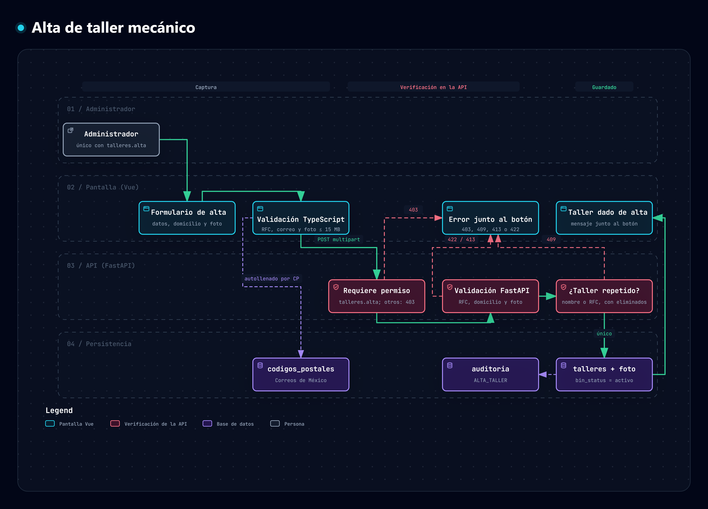

# Fase 3 · Alta de taller mecánico

**Objetivo.** Registrar los talleres a los que se asocian empleados y clientes. Estado: ✅ hecha y probada.

**Precondición.** Sólo el **administrador** puede dar de alta un taller. El permiso `talleres.alta` está reservado al administrador: **no se puede delegar** a ningún rol, ni de fábrica ni personalizado. El recepcionista conserva `talleres.consultar` (ver la lista de talleres y sus fotos) y por eso tampoco usa el catálogo de códigos postales, que forma parte del alta.

## Mapa del proceso

*Del formulario al registro: captura y autollenado del domicilio, validaciones en TypeScript y en FastAPI, control de duplicados, guardado con auditoría y los rechazos que se muestran junto al botón.* Generado con Archify; la versión interactiva (con zoom y búsqueda) está en [`alta-taller.html`](../.archify/mapas-procesos-20261009-150000/alta-taller.html) y su especificación en [`alta-taller.json`](../.archify/mapas-procesos-20261009-150000/alta-taller.json).

## 1. Campos

Los de la pantalla de referencia (detalle y reglas en [`plan_estructura_de_trabajo.md`](../plan_estructura_de_trabajo.md#4-campos-del-alta-de-taller-pantalla-de-referencia)):

| Sección | Campos |
| --- | --- |
| Datos del taller | Nombre del taller mecánico *, RFC *, Email de contacto * |
| Domicilio del taller | Calle y número *, Colonia *, Código postal *, Estado *, Municipio o alcaldía * |
| Foto del taller | Foto * (JPG, PNG o WebP, máximo 15 MB) |

## 2. Autollenado del domicilio

| Camino | Comportamiento |
| --- | --- |
| **Con código postal** | Al completar los 5 dígitos se consulta `GET /api/catalogos/codigo-postal/{cp}` y se **prellenan estado, municipio y colonia**. Si el código tiene una sola colonia, se selecciona; si tiene varias, se elige. |
| **Sin código postal** | Se elige **estado** (32) → **municipio** (sólo los de ese estado) → **colonia** (cada una muestra su C.P.). Al elegir la colonia se **carga el código postal**. |
| Código inexistente | Mensaje «No encontramos ese código postal; elija estado, municipio y colonia» y se limpian los campos derivados. |

Cambiar el estado o el municipio reinicia los campos que dependen de ellos. El servidor **vuelve a comprobar** que código postal, estado, municipio y colonia se correspondan (`422` si no).

### Origen de los datos

Catálogo Nacional de Códigos Postales de Correos de México, descargado de `https://www.correosdemexico.gob.mx/datosabiertos/cp/cpdescarga.txt` (14 MB, ISO-8859-1, columnas separadas por «|»).

| Dato | Valor |
| --- | --- |
| Asentamientos importados | 145 282 (se descartaron renglones idénticos de los 145 420 del archivo) |
| Códigos postales | 32 292 |
| Estados / municipios | 32 / 2 458 |
| Tabla | `codigos_postales` (índices por código postal y por estado + municipio) |
| Importador | `backend/scripts/importar_codigos_postales.py` (`--reemplazar` para recargar) |

> ⚠️ **El archivo publicado en esa dirección es de octubre de 2017.** Faltan los códigos postales posteriores. Debe reimportarse un catálogo actualizado. Correos de México lo ofrece de forma gratuita para uso personal: por eso `backend/data/` no se versiona.

## 3. Validaciones

| Regla | Frontend | Backend |
| --- | --- | --- |
| **RFC con expresión regular**: `^[A-ZÑ&]{3,4}\d{2}(0[1-9]\|1[0-2])(0[1-9]\|[12]\d\|3[01])[A-Z0-9]{3}$` (3 letras = persona moral, 12 caracteres; 4 letras = persona física, 13) | ✅ | ✅ |
| La fecha del RFC existe en el calendario (no hay 30 de febrero ni 31 de abril) | ✅ | ✅ |
| El RFC se guarda en mayúsculas | ✅ (mientras se escribe) | ✅ |
| **Taller único**: no se repite el nombre (sin distinguir mayúsculas) ni el RFC | — | ✅ `409` |
| Un taller eliminado también bloquea el nombre y el RFC, y el mensaje sugiere restaurarlo | — | ✅ |
| Foto: JPG, PNG o WebP **verificado por los bytes del archivo**, no por la extensión | ✅ | ✅ |
| Foto: máximo 15 MB (`413` si se excede) | ✅ | ✅ |
| Email de contacto, calle (3–150), nombre (3–100), código postal (5 dígitos) | ✅ | ✅ |
| Domicilio coherente con el catálogo | (los datos salen del catálogo) | ✅ `422` |

## 4. Proceso y datos

1. La persona completa el formulario; el frontend valida y muestra los errores junto al botón.
2. `POST /api/talleres` (`multipart/form-data`, con la foto).
3. El servidor valida los datos, el domicilio contra el catálogo y los duplicados; después guarda la foto y registra el taller **y** la auditoría `ALTA_TALLER` en una sola transacción. Si el guardado falla, la foto se elimina para no dejar archivos huérfanos (las altas rechazadas por validación nunca llegan a guardar la foto, y eso sí está probado; el borrado tras un fallo real de la base no se simuló).
4. La pantalla confirma, limpia el formulario y agrega el taller a la lista «Talleres registrados».

Tabla `talleres` (se amplió la existente): `nombre` (único), `rfc` (único cuando existe), `email_contacto`, `calle`, `colonia`, `codigo_postal`, `estado`, `municipio`, `foto`, `activo`, `bin_status` → `status.id`, `created_by` → `users.id`.

La foto se guarda en `backend/uploads/talleres/` con un nombre aleatorio y se sirve en `GET /api/talleres/{id}/foto` sólo a quien tenga permiso.

## 5. Asociación con empleados y clientes

Un empleado pertenece a un taller cuando su **sucursal** coincide con el nombre del taller registrado (sin distinguir mayúsculas). Si la sucursal no está registrada, o el taller se eliminó lógicamente, el módulo de Clientes responde `403` y explica que hay que registrar el taller.

## 6. Criterios de aceptación

- [x] Sólo el administrador da de alta talleres (el recepcionista, el técnico, el invitado y cualquier rol personalizado reciben `403`).
- [x] El permiso `talleres.alta` no se puede asignar a un rol personalizado, ni siquiera escribiéndolo en la base.
- [x] El menú, el panel y la ruta `/talleres/nuevo` sólo aparecen para el administrador.
- [x] Escribir un código postal prellena estado, municipio y colonia.
- [x] Sin código postal, estado → municipio → colonia carga el código postal.
- [x] Se rechazan RFC mal formados, con fecha imposible o repetidos, y nombres repetidos.
- [x] Se rechazan fotos que no son imagen (aunque se llamen `.png`), de otro formato o de más de 15 MB.
- [x] Una alta rechazada no deja archivos sueltos.
- [x] El alta queda en la auditoría.

Pruebas: `backend/tests/e2e_roles_talleres.py` (78 comprobaciones; también ejecutada en SQL Server) y revisión manual de la pantalla en el navegador.

## 7. Pendiente

- **Módulo de administración de talleres** (fase 6): consultar, editar, eliminar lógicamente, restaurar y ver la foto.
- Reimportar un catálogo de códigos postales actualizado.
- Los talleres que existían antes (creados a partir de la sucursal de un empleado, p. ej. el taller «1») no tienen RFC ni domicilio.

- **Administración:** consultar, editar, eliminar con borrado lógico y restaurar los talleres registrados se documenta en [`administrar_talleres.md`](administrar_talleres.md).
