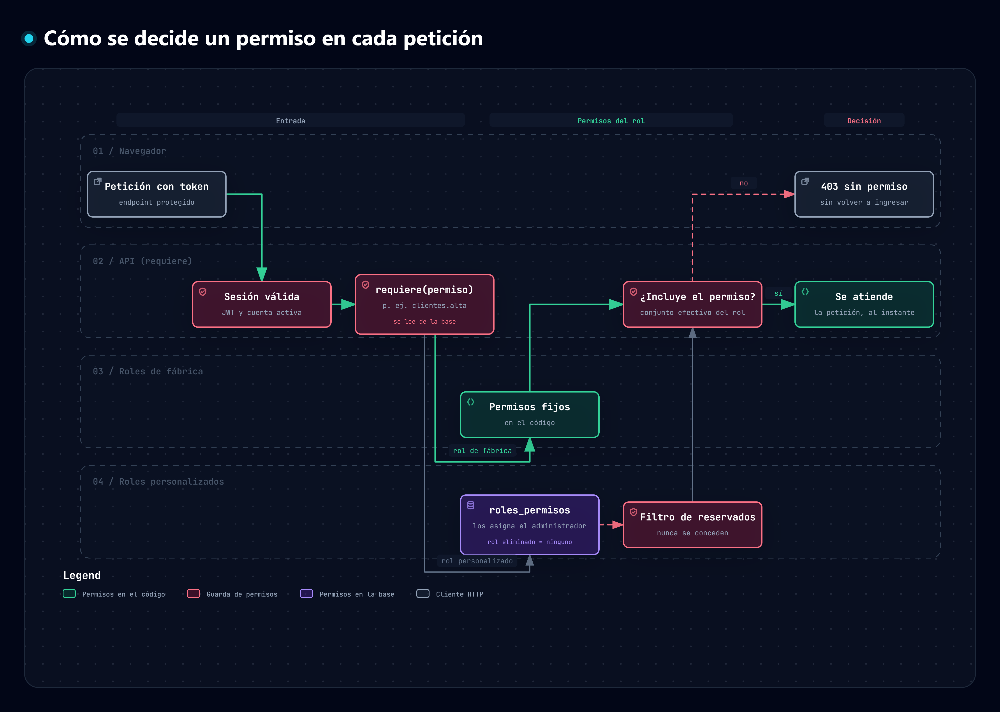

# Fase 2.1 · Permisos de los roles

**Objetivo.** Que cada rol personalizado tenga permisos concretos que defina el administrador, de modo que quien lo tenga pueda usar los módulos que le corresponden. Estado: ✅ hecha y probada.

## Mapa del proceso

*Camino de una petición protegida: sesión válida, lectura de los permisos del rol (fijos en el código o asignados en la base, con el filtro de reservados) y decisión 200 o 403.* Generado con Archify; la versión interactiva (con zoom y búsqueda) está en [`permisos-roles.html`](../.archify/mapas-procesos-20261009-150000/permisos-roles.html) y su especificación en [`permisos-roles.json`](../.archify/mapas-procesos-20261009-150000/permisos-roles.json).

## 1. Modelo

| Concepto | Detalle |
| --- | --- |
| **Permiso** | Una capacidad concreta que la API realmente protege (p. ej. «Dar de alta clientes»). El catálogo está en el código (`app/permisos.py`) y se siembra en la tabla `permisos` al arrancar. |
| **Roles de fábrica** | Tienen permisos **fijos** en el código (`PERMISOS_SISTEMA`). Reproducen exactamente las reglas que la API ya aplicaba: nada cambia para ellos. |
| **Roles personalizados** | Sus permisos se guardan en la tabla `roles_permisos` (rol ↔ permiso) y los edita el administrador. |
| **Se aplican en cada petición** | Los permisos se leen de la base en cada solicitud: un cambio surte efecto **al instante**, sin que la persona vuelva a iniciar sesión. |
| **Rol eliminado** | No concede ningún permiso mientras esté eliminado. Al restaurarlo, vuelven los que tenía. |

### Catálogo (17 permisos)

| Código | Módulo | Qué permite | ¿Se puede delegar? |
| --- | --- | --- | --- |
| `empleados.alta` | Administración | Dar de alta empleados y asignarles un rol | ❌ sólo administrador |
| `empleados.administrar` | Administración | Consultar, editar, asignar rol y eliminar empleados y cuentas invitadas | ❌ sólo administrador |
| `roles.administrar` | Administración | Crear, editar y eliminar roles y definir sus permisos | ❌ sólo administrador |
| `talleres.consultar` | Talleres | Ver la lista de talleres y sus fotos | ✅ |
| `talleres.alta` | Talleres | Registrar talleres y usar el catálogo de códigos postales | ❌ sólo administrador |
| `talleres.administrar` | Talleres | Editar talleres, cambiar su foto, eliminarlos (borrado lógico) y restaurarlos | ❌ sólo administrador |
| `clientes.consultar` | Clientes | Buscar clientes y ver su ficha | ✅ |
| `clientes.alta` | Clientes | Registrar clientes (con alerta de duplicados) | ✅ |
| `clientes.administrar` | Clientes | Administrar clientes: modificar sus datos con trazabilidad y ver su historial | ❌ roles de fábrica |
| `clientes.suspender` | Clientes | Suspender y reactivar clientes | ❌ sólo administrador |
| `vehiculos.registrar` | Vehículos | Registrar un vehículo y asociarlo a un cliente | ❌ roles de fábrica |
| `vehiculos.consultar` | Vehículos | Ver los vehículos registrados | ❌ roles de fábrica |
| `recepciones.registrar` | Recepción de vehículos | Registrar la entrada de un vehículo | ✅ *(módulo en desarrollo)* |
| `ordenes.consultar` | Órdenes de trabajo | Ver las órdenes | ✅ *(módulo en desarrollo)* |
| `ordenes.corregir` | Órdenes de trabajo | Corregir la información de una orden | ✅ *(módulo en desarrollo)* |
| `diagnosticos.registrar` | Diagnósticos | Registrar diagnósticos y reparaciones | ✅ *(módulo en desarrollo)* |
| `notificaciones.consultar` | Notificaciones | Ver las notificaciones | ✅ *(módulo en desarrollo)* |

Los marcados *en desarrollo* ya se protegen en la API, pero su módulo todavía no tiene funcionalidad (hoy devuelven un mensaje fijo).

### Permisos de los roles de fábrica

| Rol | Permisos |
| --- | --- |
| Administrador | Todos los de administración, talleres, **administrar y suspender clientes**, vehículos, recepciones, órdenes, diagnósticos y notificaciones. **No** da de alta ni consulta clientes de un taller (no tiene sucursal; los clientes pertenecen a un taller). |
| Recepcionista | `clientes.consultar`, `clientes.alta`, `clientes.administrar`, `vehiculos.registrar`, `vehiculos.consultar`, `talleres.consultar`, `recepciones.registrar`, `ordenes.consultar` |
| Asesor de servicio | `clientes.consultar`, `clientes.alta`, `ordenes.consultar`, `ordenes.corregir` |
| Técnico | `ordenes.consultar`, `diagnosticos.registrar` |
| Cliente | `notificaciones.consultar` |
| Sistema, Invitado | ninguno |

## 2. Por qué los de administración no se delegan

`empleados.alta`, `empleados.administrar`, `roles.administrar`, `talleres.alta` y `talleres.administrar` quedan **reservados al administrador**. (Los tres primeros por riesgo de escalada de privilegios; el alta y la administración de talleres por decisión del negocio: sólo el administrador registra y mantiene talleres.) Si un rol personalizado pudiera recibir «Administrar roles y permisos», cualquiera con ese rol podría concederse todos los demás permisos: sería una escalada de privilegios. La API lo rechaza (`422`) y, además, **aunque alguien lo escribiera directamente en la base, nunca se concede** (se filtra al leer).

## 3. Cómo se usa

| Elemento | Detalle |
| --- | --- |
| Pantalla | `/roles` («Roles y permisos»): cada rol muestra cuántos permisos tiene; el botón del escudo abre el diálogo de permisos |
| Diálogo | Permisos agrupados por módulo, con casillas. Los de administración aparecen bloqueados («Sólo administrador»). En un rol de fábrica el diálogo es de sólo lectura. Avisa cuántos empleados tienen el rol. |
| Alta de empleado | La vista previa muestra los permisos reales del rol elegido y avisa si no tiene ninguno |
| Menú y panel | Muestran sólo lo que la persona puede usar (según sus permisos); las rutas que no le corresponden la devuelven al panel |

## 4. API

| Método | Ruta | Requiere | Detalle |
| --- | --- | --- | --- |
| GET | `/api/permisos` | `roles.administrar` | Catálogo completo con `delegable` y `en_desarrollo` |
| GET | `/api/roles/{id}/permisos` | `roles.administrar` | Permisos del rol y si es editable (de fábrica o eliminado: no) |
| PUT | `/api/roles/{id}/permisos` | `roles.administrar` | Reemplaza el conjunto de permisos de un rol **personalizado** (`409` si es de fábrica o está eliminado; `422` si hay un permiso desconocido o reservado) |
| GET | `/api/auth/me` y `POST /api/auth/login` | sesión | Incluyen `permisos` (código y nombre) |

Cada endpoint protegido ahora declara el permiso que exige (`requiere("clientes.alta")`, etc.) en lugar de una lista de roles.

## 5. Clientes: la cadena de guardas por permiso

La cadena de responsabilidad del módulo de Clientes (`AutorizacionHandler`) ahora exige el **permiso** de la operación: `clientes.alta` para abrir el alta y dar de alta, `clientes.consultar` para buscar y ver la ficha. Así un rol puede, por ejemplo, consultar clientes sin poder crearlos.

## 6. Criterios de aceptación

- [x] Un rol personalizado recién creado no tiene permisos y la persona que lo tiene no accede a nada.
- [x] Al asignar permisos, la persona accede **sólo** a lo asignado, sin volver a iniciar sesión.
- [x] Al quitar un permiso, el acceso se pierde de inmediato (`403`).
- [x] Un rol eliminado no concede permisos; al restaurarlo vuelven.
- [x] No se pueden asignar `empleados.alta` ni `roles.administrar`, ni siquiera escribiéndolos en la base.
- [x] Los roles de fábrica conservan exactamente su comportamiento anterior.
- [x] Los permisos de un rol de fábrica no se pueden cambiar.
- [x] El menú, los botones del panel y las rutas dependen de los permisos.

Pruebas: `backend/tests/e2e_permisos.py` (62 comprobaciones; también ejecutada en SQL Server) más el resto de suites, que siguen pasando sin cambios en el comportamiento de los roles de fábrica.

## 7. Decisiones y pendientes

- **Tablas nuevas:** `permisos` y `roles_permisos`. No modifican tablas existentes.
- Los cambios de permisos no quedan en la **auditoría** (la tabla de auditoría exige un taller y el administrador no tiene uno). Pendiente.
- Una persona con `talleres.consultar` pero sin `talleres.alta` tiene acceso a la API, pero todavía no hay pantalla para ella (la lista de talleres está dentro del alta). Llegará con el módulo de administración de talleres.
- En el navegador, el menú se actualiza al recargar la página (o al volver a ingresar); la **API aplica los cambios de inmediato**.
- **Pendiente:** módulo de administración de clientes. (La administración de empleados y la de talleres ya existen: ver [`administrar_empleados.md`](administrar_empleados.md) y [`administrar_talleres.md`](administrar_talleres.md).)

- **Cambio posterior:** `talleres.alta` dejó de ser delegable y se retiró al recepcionista. Al arrancar, la API retira de la base cualquier concesión de un permiso que haya dejado de ser delegable.
- **Cambio posterior:** se agregaron `clientes.administrar`, `clientes.suspender`, `vehiculos.registrar` y `vehiculos.consultar`. Son **no delegables** porque la especificación los asigna a roles concretos (recepcionista y administrador; la suspensión, sólo al administrador). Si el negocio quisiera delegarlos, basta con quitar `delegable=False` en `app/permisos.py`.
