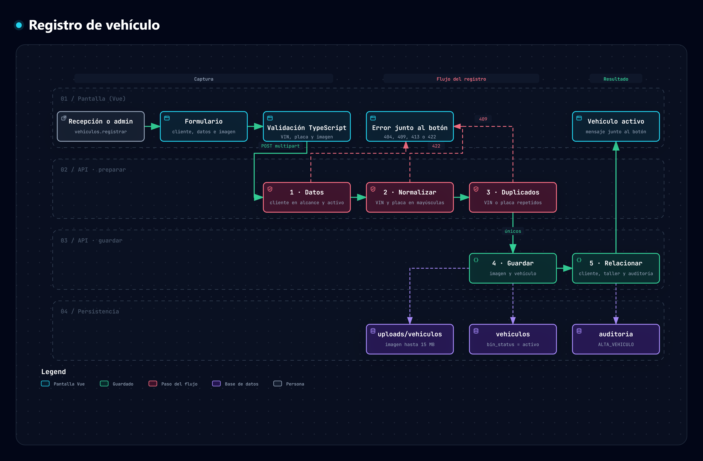

# Fase 7 · Registrar vehículos

**Objetivo.** Un módulo para registrar vehículos, que sólo usan el recepcionista y el administrador, y en el que cada vehículo queda **asociado a un cliente**. Estado: ✅ hecho y probado.

## Mapa del proceso

*Del formulario al vehículo activo: validación en TypeScript, los tres pasos de preparación en la API (datos, normalizar, duplicados), guardado y relación con el cliente.* Generado con Archify; versión interactiva en [`registro-vehiculo.html`](../.archify/mapas-procesos-20261009-150000/registro-vehiculo.html) y especificación en [`registro-vehiculo.json`](../.archify/mapas-procesos-20261009-150000/registro-vehiculo.json).

## 1. Flujo

**Datos del vehículo → normalizar → duplicados → guardar → relacionar.** Resultado: **vehículo activo**. Todo ocurre en una sola transacción: si algún paso falla no queda ni el vehículo ni su imagen.

| # | Paso | Qué hace | Si falla |
| --- | --- | --- | --- |
| 1 | **Datos** | Recibe el formulario y la imagen; comprueba que el cliente exista, esté en el alcance de la persona y **no esté suspendido** | `404` / `409` |
| 2 | **Normalizar** | VIN y placa en mayúsculas y sin espacios, guiones ni puntos; textos sin espacios sobrantes (si todo está en minúsculas se capitaliza: «honda» → «Honda»; «BMW» y «CX-5» se respetan) | `422` |
| 3 | **Duplicados** | Ni el VIN ni la placa pueden repetirse en todo el sistema (aunque se escriban distinto: `abc 123 d` = `ABC-123-D`) | `409` |
| 4 | **Guardar** | Almacena la imagen y crea el vehículo | `413` / `422` |
| 5 | **Relacionar** | Lo vincula al cliente (y a su taller) y deja el vínculo en la auditoría, visible en el historial del cliente | — |

## 2. Datos

| Campo | Regla | Obligatorio |
| --- | --- | --- |
| Cliente | Un cliente **activo** de su alcance | Sí |
| **VIN** | Expresión regular `^[A-HJ-NPR-Z0-9]{17}$` (ISO 3779: 17 caracteres, sin I, O ni Q). Ej. `1HGCM82633A004352` | Sí |
| **Placa** | Expresión regular `^(?=.*[A-Z])(?=.*\d)[A-Z0-9]{5,7}$` sobre la placa normalizada: 5 a 7 caracteres que combinan letras y números. Ej. `ABC-123-D` → `ABC123D` | Sí |
| Marca | 2 a 40 caracteres | Sí |
| Modelo | 1 a 60 caracteres | Sí |
| Año | De 1981 (desde cuando el VIN es de 17 caracteres) hasta el año siguiente al actual | Sí |
| Color | 3 a 30 caracteres | Sí |
| **Imagen** | JPG, PNG o WebP, **máximo 15 MB**; el tipo se identifica por sus bytes, no por la extensión | Sí |
| **Kilometraje** | Entero de 0 a 2 000 000 | **Opcional** |

Las expresiones regulares y las demás reglas están en `backend/app/vehiculos/validaciones.py` y se replican en `frontend/src/vehiculos.ts`. El servidor es la autoridad.

> La placa mexicana varía por estado y por tipo de vehículo; la expresión es deliberadamente general. Si el negocio necesita un formato por estado, se acota en ese archivo.

## 3. Quién y dónde

| Elemento | Detalle |
| --- | --- |
| Permisos | `vehiculos.registrar` y `vehiculos.consultar`, reservados a roles de fábrica (recepcionista y administrador); no se delegan |
| Alcance | La recepcionista registra y ve los vehículos de **su taller**; el administrador, los de **todos** |
| Menú | **Vehículos** → Vehículos y Registrar vehículo; también hay un atajo desde «Administrar clientes» con el cliente ya elegido |
| `/vehiculos/nuevo` | Formulario: selector de cliente con búsqueda, datos del vehículo e imagen con arrastrar y soltar. El éxito o el error aparecen **junto al botón** |
| `/vehiculos` | Lista con miniatura, marca, modelo, año, placa, VIN, color, kilometraje, cliente y (administrador) taller; búsqueda por placa, VIN, marca, modelo o cliente |

## 4. API

| Método | Ruta | Requiere | Detalle |
| --- | --- | --- | --- |
| POST | `/api/vehiculos` | `vehiculos.registrar` | `multipart/form-data`: `customer_id`, `vin`, `placa`, `marca`, `modelo`, `anio`, `color`, `kilometraje` (opcional) y `foto`. Responde `201` con el vehículo `ACTIVO` |
| GET | `/api/vehiculos?buscar=&customer_id=&pagina=&tamano=` | `vehiculos.consultar` | Búsqueda y paginación dentro del alcance |
| GET | `/api/vehiculos/{id}/foto` | `vehiculos.consultar` | Imagen, con la sesión (el navegador la descarga con el token) |

## 5. Datos

Tabla nueva **`vehiculos`** (no modifica las existentes; la crea `create_all` al arrancar): `customer_id` y `taller_id` (FK), `vin` y `placa` **únicos**, `marca`, `modelo`, `anio`, `color`, `kilometraje` (nulo), `foto`, `bin_status` (FK a `status`; 1 = activo), `created_by`, `created_at`. La imagen se guarda en `backend/uploads/vehiculos/`.

## 6. Criterios de aceptación

- [x] Sólo recepcionista y administrador registran y consultan vehículos (asesor, técnico y personalizados: `403`).
- [x] El vehículo queda asociado a un cliente y hereda su taller; un cliente de otro taller o suspendido se rechaza.
- [x] VIN y placa se validan con expresión regular y se normalizan; no se pueden repetir.
- [x] La imagen es obligatoria, de hasta 15 MB y validada por su contenido; el kilometraje es opcional.
- [x] El resultado es un vehículo **activo** (`bin_status = 1`).
- [x] Un rechazo no deja imágenes huérfanas ni registros a medias.
- [x] Validaciones en TypeScript y en FastAPI.

Pruebas: `backend/tests/e2e_clientes_vehiculos.py`.

## 7. Pendientes

- Editar, eliminar (borrado lógico) y restaurar vehículos, y transferirlos de cliente.
- Que las órdenes de trabajo y la recepción de vehículos usen este registro.
- Consultar los vehículos desde la ficha del cliente.
