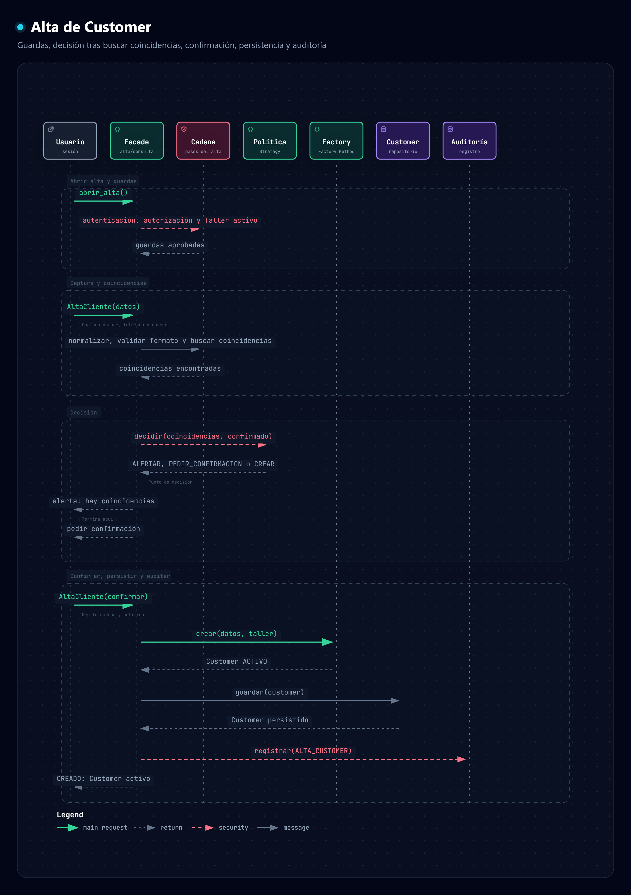
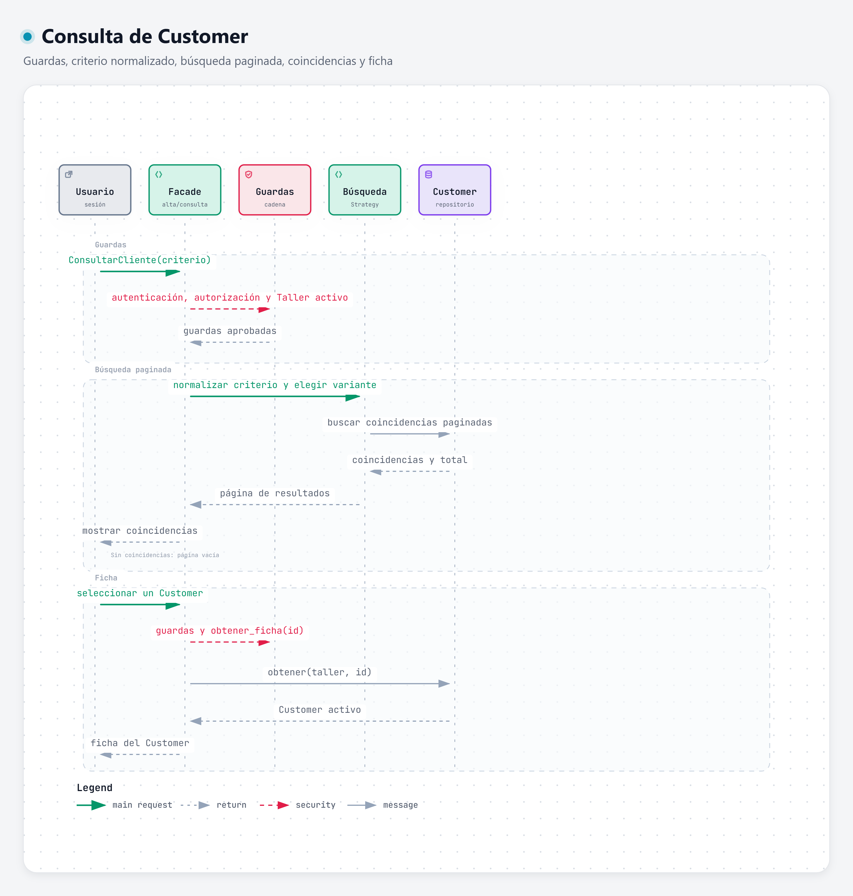

# Patrones de diseño · Gestión de Clientes (Customer)

Diseño del módulo de **Clientes** con patrones creacional, estructural y de comportamiento, con diagramas generados con [Archify](../../tools/archify) y un esqueleto de código en Python (el lenguaje del backend).

> **Estado:** implementado y conectado. El código vive en [`backend/app/customers/`](../../backend/app/customers) (API y SQL Server) y las pantallas en `frontend/src/views/Cliente*.vue`. El rol **Recepcionista** (y Asesor de servicio) puede dar de alta y consultar clientes; ver el [README principal](../../README.md#cómo-probar-el-módulo-de-clientes). Además se puede ejecutar con repositorios en memoria (ver [Cómo ejecutar el ejemplo](#cómo-ejecutar-el-ejemplo)).

## Alcance

- **Precondición:** Usuario autenticado y autorizado, dentro de un Taller activo.
- **Datos del cliente:** ID (lo asigna el sistema), nombre completo, teléfono y correo.
- **Reglas:** validar formato, alertar duplicados y **no crear automáticamente un segundo registro**.
- **Resultado esperado:** un `Customer` activo.
- **Entidades:** sólo `Customer`, `Taller`, `Usuario` y `Auditoría`.

| Flujo | Pasos |
| --- | --- |
| **Alta de Cliente** | abrir alta → captura → normalizar → buscar coincidencias → confirmar → persistir → auditar |
| **Consultar Cliente** | criterio → normalización → búsqueda paginada → coincidencias → ficha |

## Patrones elegidos

| Patrón | Categoría | Problema que resuelve | Clases participantes | Justificación |
| --- | --- | --- | --- | --- |
| [**Factory Method**](factory-method/README.md) | Creacional | Un `Customer` sólo debe crearse tras decidir que no hay duplicado, siempre activo y con datos normalizados. | `CustomerCreator` (Creator), `CustomerActivoCreator` (ConcreteCreator), `Customer` (Product), `Taller` | Da un único punto de creación con su invariante (“nace ACTIVO”) y deja la construcción en una subclase. Los otros cuatro patrones creacionales no encajan con el flujo (ver abajo). |
| [**Facade**](facade/README.md) *(obligatorio)* | Estructural | Quien llama no debe conocer normalización, búsqueda, paginación, persistencia ni auditoría. | `CustomerFacade`, cadena de alta, `PoliticaDuplicados`, `CustomerCreator`, `EstrategiaBusqueda`, `CustomerRepositorio`, `Auditoría` | Une `AltaCliente()` y `ConsultarCliente()` en una interfaz mínima y garantiza que las guardas siempre se ejecuten primero. |
| [**Chain of Responsibility**](chain-of-responsibility/README.md) | Comportamiento | El alta es una cadena de pasos que debe cortarse al primer incumplimiento. | `Manejador`, `AutenticacionHandler`, `AutorizacionHandler`, `TallerActivoHandler`, `FormatoHandler`, `CoincidenciasHandler` | Cada paso es una clase pequeña y comprobable por separado; las guardas se reutilizan en la consulta. |
| [**Strategy**](strategy/README.md) | Comportamiento | La búsqueda paginada y la decisión ante duplicados tienen variantes que no deben vivir en `if` dentro de la Facade. | `EstrategiaBusqueda`, `BusquedaPorContacto`, `BusquedaPorNombre`, `PoliticaDuplicados`, `AlertarSinAutoCrear` | Aísla “cómo buscar” y “qué hacer con las coincidencias”. La regla de no auto-crear queda en una sola clase. |

## Evaluación de los patrones descartados

### Creacionales

| Patrón | Resultado | Motivo frente al flujo de alta y la regla de no duplicar |
| --- | --- | --- |
| Builder | Descartado | Sirve para objetos con muchos campos opcionales. `Customer` sólo exige dos datos mínimos. |
| **Factory Method** | **Elegido** | Centraliza la creación, la hace condicional a la decisión de duplicados y fija el estado inicial. |
| Abstract Factory | Descartado | Crea familias de objetos relacionados; aquí hay un solo producto. |
| Prototype | Descartado | Clona una instancia existente; clonar un `Customer` es justo lo que la regla prohíbe. |
| Singleton | Descartado | Garantiza una única instancia de una clase, no un único registro de cliente. La regla de no duplicar se resuelve con la búsqueda de coincidencias, no con el número de instancias. Además introduce estado global difícil de probar. |

> Con un solo producto, hoy Factory Method aporta sobre todo el punto único de creación y su invariante; la variación futura (otra forma de construir un Customer) no requeriría tocar la Facade.

### Comportamiento

| Patrón | Resultado | Motivo |
| --- | --- | --- |
| **Chain of Responsibility** | **Elegido** | Los pasos del alta son una secuencia con salida temprana. |
| **Strategy** | **Elegido** | Cubre la decisión ante duplicados y la búsqueda paginada. |
| Template Method | Descartado como patrón principal | Aparece de forma incidental dentro de `CustomerCreator.crear()` y `Manejador.manejar()`, pero los pasos del alta no comparten un esqueleto con huecos que varíen. |
| Command | Descartado | Útil para encolar, deshacer o registrar solicitudes; no se pide ninguna de las tres. |
| State | Descartado | `Customer` sólo tiene el estado ACTIVO como resultado esperado y no hay transiciones definidas. |
| Observer | Descartado | La auditoría es parte síncrona del alta y hay un solo destinatario; no hay suscriptores que desacoplar. |
| Iterator | Descartado | Recorre colecciones. `PaginaResultados` ya resuelve la paginación y no ayuda a decidir si se crea o no. |

## Diagramas

Cada imagen se generó con Archify; el HTML interactivo (zoom, temas claro/oscuro, exportación) está en [`.archify/customer-patterns-20261002-120000/`](../../.archify/customer-patterns-20261002-120000). Archify no tiene un tipo “diagrama de clases”: cada clase se dibuja como un componente (nombre, métodos y rol del patrón) del tipo *architecture*, con flechas para las relaciones.

| Diagrama | Imagen | HTML interactivo |
| --- | --- | --- |
| Clases · Factory Method | [PNG](diagrams/factory-method.png) | [factory-method.html](../../.archify/customer-patterns-20261002-120000/factory-method.html) |
| Clases · Facade | [PNG](diagrams/facade.png) | [facade.html](../../.archify/customer-patterns-20261002-120000/facade.html) |
| Clases · Chain of Responsibility | [PNG](diagrams/chain-of-responsibility.png) | [chain-of-responsibility.html](../../.archify/customer-patterns-20261002-120000/chain-of-responsibility.html) |
| Clases · Strategy | [PNG](diagrams/strategy.png) | [strategy.html](../../.archify/customer-patterns-20261002-120000/strategy.html) |
| Secuencia · Alta de Cliente | [PNG](diagrams/alta-cliente-sequence.png) | [alta-cliente-sequence.html](../../.archify/customer-patterns-20261002-120000/alta-cliente-sequence.html) |
| Secuencia · Consultar Cliente | [PNG](diagrams/consulta-cliente-sequence.png) | [consulta-cliente-sequence.html](../../.archify/customer-patterns-20261002-120000/consulta-cliente-sequence.html) |

### Secuencia · Alta de Cliente

Muestra la guarda (autenticación, autorización y Taller activo), el **punto de decisión** tras buscar coincidencias y la rama que persiste y audita.



### Secuencia · Consultar Cliente



## Código

Todo en [`backend/app/customers/`](../../backend/app/customers):

| Archivo | Contenido | Patrón |
| --- | --- | --- |
| [`dominio.py`](../../backend/app/customers/dominio.py) | `Customer`, `Taller`, `Usuario`, `Auditoria`, páginas y respuestas | — |
| [`normalizacion.py`](../../backend/app/customers/normalizacion.py) | Limpieza de nombre, teléfono y correo; validación de formato | — |
| [`puertos.py`](../../backend/app/customers/puertos.py) | Interfaces `CustomerRepositorio` y `AuditoriaRepositorio` | — |
| [`fabrica.py`](../../backend/app/customers/fabrica.py) | `CustomerCreator`, `CustomerActivoCreator` | Factory Method |
| [`cadena.py`](../../backend/app/customers/cadena.py) | `Manejador` y los cinco handlers | Chain of Responsibility |
| [`estrategias.py`](../../backend/app/customers/estrategias.py) | Búsquedas y política de duplicados | Strategy |
| [`fachada.py`](../../backend/app/customers/fachada.py) | `CustomerFacade` | Facade |
| [`modelos.py`](../../backend/app/customers/modelos.py) | Tablas `talleres`, `customers` (con claves únicas taller + correo y taller + teléfono) y `auditoria` | — |
| [`repositorio_sql.py`](../../backend/app/customers/repositorio_sql.py) | Repositorios SQLAlchemy; no hacen commit para que Customer y Auditoría se guarden juntos | — |
| [`api.py`](../../backend/app/customers/api.py) | Endpoints `/api/customers`, resolución del Taller y traducción de reglas a códigos HTTP | — |
| [`ejemplo.py`](../../backend/app/customers/ejemplo.py) | Repositorios en memoria y recorrido completo | — |

### Cómo ejecutar el ejemplo

```powershell
cd backend
.\.venv\Scripts\python.exe -m app.customers.ejemplo
```

Imprime, entre otros, estos casos: alta pendiente de confirmación, alta creada, segundo alta con el mismo nombre (devuelve la coincidencia y **no** crea el registro), consulta con ficha, y las tres guardas (`NO_AUTENTICADO`, `NO_AUTORIZADO`, `TALLER_INACTIVO`).

## Decisiones de diseño

- **El alta tiene dos pasos para el usuario.** `AltaCliente(datos)` busca coincidencias; si no hay, responde `PENDIENTE_CONFIRMACION`. Al confirmar, `AltaCliente(datos, confirmar=True)` repite la cadena completa antes de crear, así una coincidencia que apareció entre ambas llamadas también se detecta.
- **Una coincidencia nunca crea.** `AlertarSinAutoCrear` no ofrece forma de omitir la alerta. Si el negocio quisiera permitir una confirmación expresa, bastaría otra `PoliticaDuplicados`, sin tocar la Facade.
- **Coincidencias por teléfono exacto, por correo exacto o por nombre**, normalizados (sin acentos ni mayúsculas): “María López” y “maria lopez” coinciden.
- **Formato:** el nombre necesita al menos dos palabras; el teléfono tiene de 10 a 15 dígitos y el correo es válido (ambos obligatorios).
- **Autorización por permiso:** abrir el alta y dar de alta exigen `clientes.alta`; buscar y ver la ficha exigen `clientes.consultar`. Los conceden los roles (de fábrica: Recepcionista y Asesor de servicio; personalizados: los que el administrador configure). El administrador no tiene estos permisos: no tiene sucursal y los clientes pertenecen a un Taller.
- **Taller:** es el taller **registrado** (alta de taller) cuyo nombre coincide con la sucursal del usuario, sin distinguir mayúsculas. Ya no se crea solo: si la sucursal no está registrada, o el taller fue eliminado lógicamente, la guarda responde `TALLER_INACTIVO` (403) con un mensaje que indica registrar el taller.
- **Duplicados, también en la base:** además de la búsqueda, `customers` tiene claves únicas (taller, correo) y (taller, teléfono). Si dos altas simultáneas pasan la búsqueda, la base rechaza la segunda (`409`).
- **Atomicidad:** el endpoint hace un solo `commit` tras guardar el Customer y su Auditoría; si algo falla, no queda ninguno.
- **Códigos HTTP:** `NO_AUTENTICADO` 401, `NO_AUTORIZADO` y `TALLER_INACTIVO` 403, `FORMATO_INVALIDO` y `PAGINA_INVALIDA` 422, `NO_ENCONTRADO` 404, `DUPLICADO` 409. Una coincidencia **no** es un error: responde `200` con `COINCIDENCIAS`.

## Verificación

- [`backend/tests/e2e_clientes.py`](../../backend/tests/e2e_clientes.py): 34 comprobaciones de punta a punta sobre SQLite (y también sobre SQL Server) (guardas, alta con y sin coincidencias, formatos, paginación, ficha y aislamiento entre talleres).
- Pantallas probadas a mano en el navegador: alta completa, alerta de duplicado, consulta paginada, ficha, caso sin resultados y bloqueo del técnico.
- Archify: los seis diagramas pasaron `validate`, `deliver` y `check` (9/9). El `browser-check` no corre en este equipo (el Chrome que usa Archify se cierra por un fallo del proceso de GPU); los PNG se exportaron con el exportador del propio visor y se revisaron a simple vista.

## Pendiente

- Pruebas unitarias de cada patrón y pruebas del frontend.
- Pantallas para administrar Talleres (activar o desactivar) y para consultar la Auditoría.
- Editar, desactivar y fusionar clientes.
- Búsqueda parcial por teléfono o correo en la consulta (hoy exige el dato completo; la administración sí busca parcialmente).
- Que el Administrador pueda operar sobre un taller elegido.
- Mapear `ReglaIncumplida("CUSTOMER_NO_ACTIVO")` (un error interno) a 500 explícito; hoy cae en 400.
