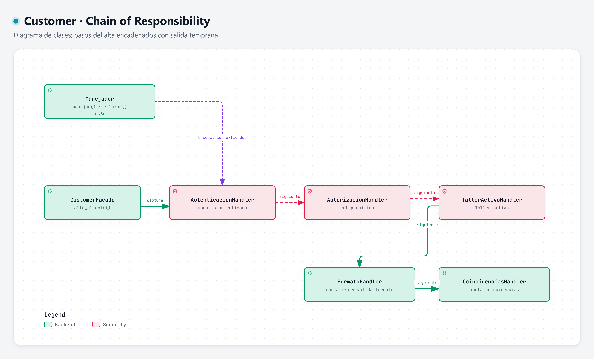

# Chain of Responsibility · pasos del alta

**Categoría:** comportamiento · **Código:** [`cadena.py`](../../../backend/app/customers/cadena.py) · [Volver al resumen](../README.md)

## Intención

Pasar una solicitud por una cadena de manejadores. Cada uno hace su parte y decide si continúa con el siguiente o corta el proceso.

## Motivación

El alta de Cliente es una secuencia de verificaciones con **salida temprana**: no tiene sentido normalizar si el usuario no está autenticado, ni buscar coincidencias si el formato es inválido. Con un único método lleno de `if`:

- la Facade crecería con cada regla nueva;
- las reglas no se podrían probar por separado;
- las mismas guardas se duplicarían en la consulta.

Con la cadena, cada paso es una clase pequeña, y el orden se decide una sola vez al armarla:

```
Autenticación → Autorización → Taller activo → Formato → Coincidencias
```

| Manejador | Qué verifica | Si falla |
| --- | --- | --- |
| `AutenticacionHandler` | El Usuario tiene sesión válida | `NO_AUTENTICADO` |
| `AutorizacionHandler` | Su rol puede gestionar clientes (Recepcionista o Asesor de servicio) | `NO_AUTORIZADO` |
| `TallerActivoHandler` | El Taller está activo | `TALLER_INACTIVO` |
| `FormatoHandler` | Normaliza nombre, teléfono y correo y valida su formato | `FORMATO_INVALIDO` |
| `CoincidenciasHandler` | Busca coincidencias por teléfono, por correo y por nombre y las **anota** | no corta: deja el resultado a la política |

El último manejador no decide si crear; sólo recoge las coincidencias. La decisión pertenece a [Strategy](../strategy/README.md), lo que mantiene cada responsabilidad en un solo lugar.

### Por qué no otros patrones

| Patrón | Motivo del descarte |
| --- | --- |
| Template Method | Los pasos no comparten un esqueleto con huecos; son verificaciones independientes y reordenables. |
| Command | No hay que encolar, deshacer ni registrar solicitudes. |
| State | No hay un objeto que cambie de comportamiento según su estado. |

## Estructura



| Rol | Clase |
| --- | --- |
| Handler | `Manejador` (`enlazar`, `manejar`, `_verificar`) |
| ConcreteHandler | `AutenticacionHandler`, `AutorizacionHandler`, `TallerActivoHandler`, `FormatoHandler`, `CoincidenciasHandler` |
| Solicitud | `Solicitud` y `SolicitudAlta` (acumula los datos normalizados y las coincidencias) |
| Cliente | `CustomerFacade`, que arma y ejecuta la cadena |

Diagrama interactivo: [chain-of-responsibility.html](../../../.archify/customer-patterns-20261002-120000/chain-of-responsibility.html)

## Consecuencias

**Ventajas**
- Agregar, quitar o reordenar un paso no modifica la Facade ni los demás pasos.
- Cada handler se prueba de forma aislada.
- Las guardas (`construir_guardas(permiso)`) se reutilizan en la consulta y en la ficha, de modo que los dos flujos tienen las mismas precondiciones.

**Costos y límites**
- El orden importa y no lo impone el compilador: `CoincidenciasHandler` supone que `FormatoHandler` ya llenó `normalizados` (hay un `assert`).
- Los handlers comparten información modificando la solicitud, lo que acopla un poco unos con otros.
- La depuración exige saber en qué paso se cortó; por eso `ReglaIncumplida` lleva un código explícito.
- Una cadena que se enlaza mal (por ejemplo, sin el último eslabón) falla en silencio: conviene probar `construir_cadena_alta`.

## Ejemplo aplicado a Customer

```python
class Manejador(ABC):
    def enlazar(self, siguiente: "Manejador") -> "Manejador":
        self._siguiente = siguiente
        return siguiente

    def manejar(self, solicitud: Solicitud) -> None:
        self._verificar(solicitud)              # si incumple, lanza ReglaIncumplida y la cadena se corta
        if self._siguiente:
            self._siguiente.manejar(solicitud)

class TallerActivoHandler(Manejador):
    def _verificar(self, solicitud: Solicitud) -> None:
        if not solicitud.contexto.taller.activo:
            raise ReglaIncumplida("TALLER_INACTIVO", "El taller no está activo o su usuario no tiene un taller asignado")
```

Armado de la cadena del alta:

```python
def construir_cadena_alta(repo, por_contacto, por_nombre) -> Manejador:
    return encadenar(
        AutenticacionHandler(), AutorizacionHandler(PERMISO_ALTA), TallerActivoHandler(),
        FormatoHandler(), CoincidenciasHandler(repo, por_contacto, por_nombre),
    )
```

Resultado con un taller inactivo (`python -m app.customers.ejemplo`): `Guarda (taller inactivo) -> TALLER_INACTIVO`, sin llegar a normalizar ni buscar.
