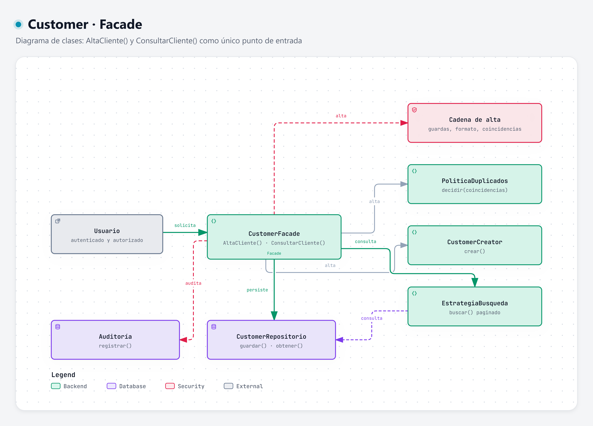

# Facade · AltaCliente() y ConsultarCliente()

**Categoría:** estructural · **Código:** [`fachada.py`](../../../backend/app/customers/fachada.py) · [Volver al resumen](../README.md)

## Intención

Ofrecer una interfaz unificada y simple a un conjunto de clases de un subsistema, de modo que el resto de la aplicación no dependa de sus detalles.

## Motivación

Para dar de alta o consultar un Cliente hay que coordinar varias piezas: guardas, normalización, validación de formato, búsqueda de coincidencias, paginación, decisión ante duplicados, creación, persistencia y auditoría. Si un endpoint o una pantalla las llamara una por una:

- cada llamador repetiría el orden correcto y podría **olvidar una guarda** o la búsqueda de coincidencias;
- cambiar un paso obligaría a tocar todos los llamadores.

`CustomerFacade` expone dos operaciones de dominio y oculta todo lo demás:

| Operación | Qué oculta |
| --- | --- |
| `AltaCliente(contexto, datos, confirmar=False)` | guardas, normalización, formato, coincidencias, decisión, creación, persistencia y auditoría |
| `ConsultarCliente(contexto, criterio, página)` | guardas, normalización del criterio, elección de la estrategia de búsqueda y paginación |
| `obtener_ficha(contexto, customer_id)` | guardas y lectura de la ficha dentro del Taller de la sesión |
| `abrir_alta(contexto)` | sólo las guardas, antes de mostrar el formulario |

Los nombres `AltaCliente` y `ConsultarCliente` son alias de `alta_cliente` y `consultar_cliente` (convención de Python).

## Estructura



| Rol | Clase |
| --- | --- |
| Facade | `CustomerFacade` |
| Subsistema | cadena de alta ([CoR](../chain-of-responsibility/README.md)), `PoliticaDuplicados` y `EstrategiaBusqueda` ([Strategy](../strategy/README.md)), `CustomerCreator` ([Factory Method](../factory-method/README.md)), `CustomerRepositorio`, `AuditoriaRepositorio` |
| Cliente | Un caso de uso o endpoint, ejecutado por un `Usuario` en un `Taller` |

Secuencias que recorre la Facade: [alta](../diagrams/alta-cliente-sequence.png) y [consulta](../diagrams/consulta-cliente-sequence.png). Diagrama interactivo: [facade.html](../../../.archify/customer-patterns-20261002-120000/facade.html)

## Consecuencias

**Ventajas**
- El llamador depende de dos operaciones, no de nueve clases.
- Las guardas **siempre** se aplican primero: no existe un camino público que persista sin pasar por ellas.
- Se puede sustituir una pieza (otra política, otro repositorio) sin cambiar la interfaz; la Facade recibe el repositorio, el auditor, la política y el creador por constructor.

**Costos y límites**
- Riesgo de convertirse en una clase “todopoderosa”. Por eso no contiene reglas: sólo orquesta y las reglas viven en handlers, estrategias y fábrica.
- No impide que alguien importe directamente las clases del subsistema; es una convención de uso, no una barrera técnica.
- La capa HTTP ([`api.py`](../../../backend/app/customers/api.py)) traduce `ReglaIncumplida` a 401, 403, 404, 409 o 422; la Facade no conoce HTTP.

## Ejemplo aplicado a Customer

```python
facade = CustomerFacade(repo, auditoria)           # política y creador tienen valores por defecto
contexto = ContextoSolicitud(Usuario(1, "RECEPCIONISTA", True), Taller(1, True))
datos = DatosCliente("María López", "maria.lopez@correo.com")

facade.AltaCliente(contexto, datos).resultado             # PENDIENTE_CONFIRMACION
facade.AltaCliente(contexto, datos, confirmar=True)       # CREADO, con Customer activo
facade.AltaCliente(contexto, DatosCliente("Maria Lopez", "otro@correo.com"), confirmar=True)
                                                           # COINCIDENCIAS: no crea un segundo registro
pagina = facade.ConsultarCliente(contexto, "maria.lopez@correo.com")
ficha = facade.obtener_ficha(contexto, pagina.items[0].id)
```

El cuerpo de `alta_cliente` muestra el papel de coordinador:

```python
solicitud = SolicitudAlta(contexto, datos, confirmar)
self._cadena_alta.manejar(solicitud)                      # guardas, formato y coincidencias
decision = self._politica.decidir(solicitud.coincidencias, confirmar)
if decision is DecisionAlta.ALERTAR_Y_NO_CREAR:
    return RespuestaAlta(ResultadoAlta.COINCIDENCIAS, coincidencias=solicitud.coincidencias)
if decision is DecisionAlta.PEDIR_CONFIRMACION:
    return RespuestaAlta(ResultadoAlta.PENDIENTE_CONFIRMACION)
customer = self._repo.guardar(self._creator.crear(solicitud.normalizados, contexto.taller))
self._auditoria.registrar(Auditoria.de("ALTA_CUSTOMER", contexto, customer, "Alta confirmada sin coincidencias"))
return RespuestaAlta(ResultadoAlta.CREADO, customer)
```
