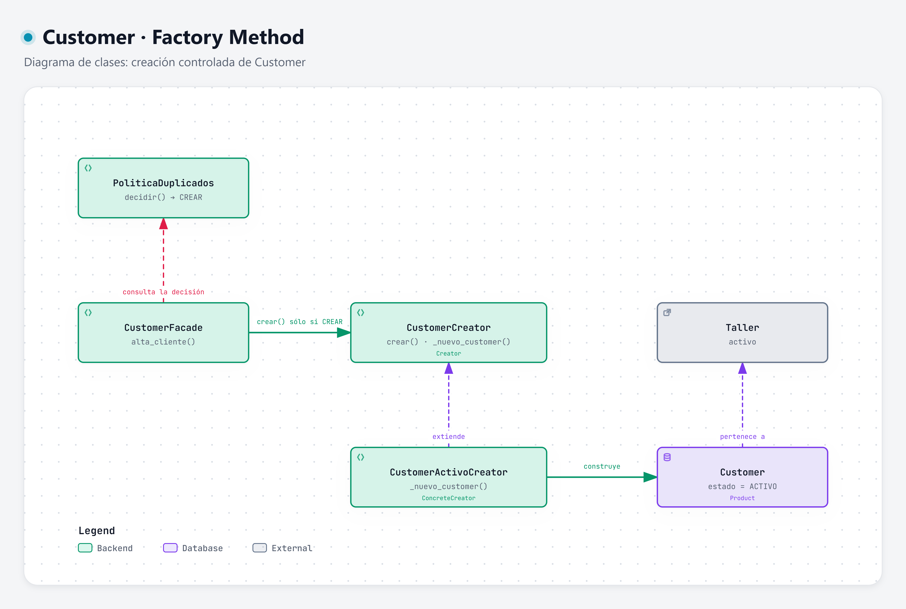

# Factory Method · creación de Customer

**Categoría:** creacional · **Código:** [`fabrica.py`](../../../backend/app/customers/fabrica.py) · [Volver al resumen](../README.md)

## Intención

Definir una operación para crear un objeto y dejar que una subclase decida cómo se construye. El código que lo necesita sólo conoce al creador, nunca la construcción concreta.

## Motivación

En el alta de Cliente, crear un `Customer` es el último paso y está sujeto a una regla: **sólo se crea si no hay coincidencias y el usuario confirmó**. Si cualquier parte del sistema pudiera escribir `Customer(...)`, esa regla se podría saltar y aparecería un segundo registro.

Con Factory Method:

- La creación pasa por un único método, `CustomerCreator.crear()`, que la Facade invoca **sólo cuando la política devolvió `CREAR`**.
- El flujo de `crear()` impone la invariante del resultado esperado: el `Customer` nace **activo**. Si una subclase devolviera otro estado, se lanza `CUSTOMER_NO_ACTIVO`.
- La construcción concreta (`_nuevo_customer`) queda en una subclase, así que cambiar cómo nace un Customer no toca la Facade.

### Por qué no los otros creacionales

| Patrón | Motivo del descarte |
| --- | --- |
| Builder | `Customer` tiene dos datos mínimos; no hay construcción por pasos ni campos opcionales que justifiquen un builder. |
| Abstract Factory | No hay familias de productos relacionados. |
| Prototype | Clonar un `Customer` existente es lo que la regla de no duplicar prohíbe. |
| Singleton | Controla cuántas instancias tiene una clase, no cuántos clientes hay. |

## Estructura



| Rol | Clase | Responsabilidad |
| --- | --- | --- |
| Creator | `CustomerCreator` | `crear(datos, taller)` fija el flujo y valida que el Customer sea ACTIVO; declara el factory method `_nuevo_customer`. |
| ConcreteCreator | `CustomerActivoCreator` | Implementa `_nuevo_customer`: arma el `Customer` con nombre, teléfono y correo normalizados, `taller_id` y estado ACTIVO. |
| Product | `Customer` | Cliente del Taller con estado `ACTIVO`. |
| Cliente | `CustomerFacade` | Llama a `crear()` sólo si `PoliticaDuplicados` devolvió `CREAR`. |

Diagrama interactivo: [factory-method.html](../../../.archify/customer-patterns-20261002-120000/factory-method.html)

## Consecuencias

**Ventajas**
- Un solo lugar donde nace un `Customer`; la regla de no duplicar no depende de que cada llamador la recuerde.
- La invariante “nace activo” se verifica en un punto.
- Se puede cambiar la forma de construir sin modificar la Facade ni la cadena.

**Costos y límites**
- Hoy hay un solo creador y un solo producto, así que el beneficio es sobre todo el punto único de creación; no hay variación real todavía.
- Añade una jerarquía de dos clases para algo que podría ser una función. Se acepta porque deja explícito el lugar de creación.
- Factory Method **no evita** duplicados por sí mismo: depende de que la Facade respete la decisión de la política (ver [Strategy](../strategy/README.md)).

## Ejemplo aplicado a Customer

```python
class CustomerCreator(ABC):
    def crear(self, datos: DatosNormalizados, taller: Taller) -> Customer:
        customer = self._nuevo_customer(datos, taller)
        if customer.estado is not EstadoCustomer.ACTIVO:
            raise ReglaIncumplida("CUSTOMER_NO_ACTIVO", "Un Customer recién creado debe quedar activo")
        return customer

    @abstractmethod
    def _nuevo_customer(self, datos: DatosNormalizados, taller: Taller) -> Customer: ...


class CustomerActivoCreator(CustomerCreator):
    def _nuevo_customer(self, datos: DatosNormalizados, taller: Taller) -> Customer:
        return Customer(None, datos.nombre_completo, datos.telefono, datos.correo, taller.id, EstadoCustomer.ACTIVO)
```

Uso dentro de la Facade, después de la decisión:

```python
if decision is DecisionAlta.CREAR:
    customer = self._repo.guardar(self._creator.crear(solicitud.normalizados, contexto.taller))
```
