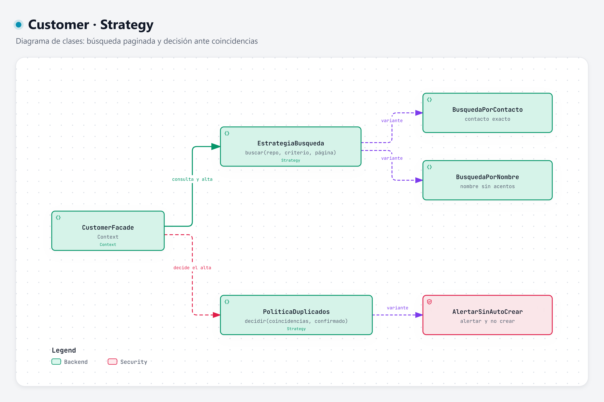

# Strategy · búsqueda paginada y decisión ante duplicados

**Categoría:** comportamiento · **Código:** [`estrategias.py`](../../../backend/app/customers/estrategias.py) · [Volver al resumen](../README.md)

## Intención

Definir una familia de algoritmos intercambiables, encapsulando cada uno, para que puedan variar sin cambiar al código que los usa.

## Motivación

Hay dos puntos del módulo donde el comportamiento tiene variantes:

1. **Cómo se busca y se pagina.** Un criterio puede ser un contacto —teléfono o correo— (coincidencia exacta con cualquiera de los dos) o un nombre (coincidencia por texto sin acentos ni mayúsculas). Poner ese `if` en la Facade la ensucia y la ata a cada tipo de búsqueda.
2. **Qué se hace con las coincidencias del alta.** La regla actual es *alertar y no crear automáticamente un segundo registro*. Es una **política de negocio**: debe estar en una sola clase, visible y fácil de cambiar si el negocio la ajusta.

| Strategy | Variantes | Contexto que la usa |
| --- | --- | --- |
| `EstrategiaBusqueda.buscar(repo, taller_id, criterio, pagina)` | `BusquedaPorContacto`, `BusquedaPorNombre` | `CustomerFacade.consultar_cliente` y `CoincidenciasHandler` |
| `PoliticaDuplicados.decidir(coincidencias, confirmado)` | `AlertarSinAutoCrear` | `CustomerFacade.alta_cliente` |

La Facade elige la búsqueda con `elegir_estrategia_consulta(criterio)` según la forma del criterio, y la paginación viaja en `SolicitudPagina` (número y tamaño, de 1 a 50) y vuelve en `PaginaResultados` (elementos, total y `hay_mas`).

### Decisión de `AlertarSinAutoCrear`

| Coincidencias | ¿Confirmó? | Decisión | Respuesta |
| --- | --- | --- | --- |
| Sí | cualquiera | `ALERTAR_Y_NO_CREAR` | `COINCIDENCIAS` (se devuelven para revisión) |
| No | No | `PEDIR_CONFIRMACION` | `PENDIENTE_CONFIRMACION` |
| No | Sí | `CREAR` | `CREADO` |

### Por qué no otros patrones

| Patrón | Motivo del descarte |
| --- | --- |
| Template Method | Las variantes no comparten un esqueleto de pasos; son algoritmos completos distintos. |
| Command | No se requiere encolar ni deshacer solicitudes. |
| State | El resultado depende de los datos de entrada, no de un estado interno que cambie con el tiempo. |
| Observer | No hay varios suscriptores que reaccionen a un evento. |
| Iterator | Es complementario para recorrer los resultados, pero no decide cómo buscar ni si se crea. La paginación ya se resuelve con `PaginaResultados`. |

## Estructura



| Rol | Clase |
| --- | --- |
| Context | `CustomerFacade` |
| Strategy | `EstrategiaBusqueda`, `PoliticaDuplicados` |
| ConcreteStrategy | `BusquedaPorContacto`, `BusquedaPorNombre`, `AlertarSinAutoCrear` |
| Colaborador | `CustomerRepositorio` (cada búsqueda delega la consulta y la página al repositorio) |

Diagrama interactivo: [strategy.html](../../../.archify/customer-patterns-20261002-120000/strategy.html)

## Consecuencias

**Ventajas**
- La regla de no auto-crear vive en una clase; el resto del sistema no la repite.
- Agregar una variante (por ejemplo, una búsqueda por fragmento de contacto) no modifica la Facade.
- Cada estrategia se prueba por separado con un repositorio falso.

**Costos y límites**
- Hoy hay una sola política; Strategy se justifica por la intención de poder cambiarla, no por tener ya variantes. Si nunca cambia, una función bastaría.
- El contexto debe conocer las estrategias para elegir una; aquí lo resuelve `elegir_estrategia_consulta`, que sí contiene un condicional.
- `BusquedaPorContacto` y `BusquedaPorNombre` son delgadas: la lógica pesada (la consulta SQL) estará en el repositorio.
- La política no puede **impedir** que otro código cree un Customer; sólo gobierna el flujo de la Facade. El punto único de creación lo da [Factory Method](../factory-method/README.md).

## Ejemplo aplicado a Customer

```python
class PoliticaDuplicados(ABC):
    @abstractmethod
    def decidir(self, coincidencias: tuple[Customer, ...], confirmado: bool) -> DecisionAlta: ...


class AlertarSinAutoCrear(PoliticaDuplicados):
    def decidir(self, coincidencias, confirmado):
        if coincidencias:
            return DecisionAlta.ALERTAR_Y_NO_CREAR
        return DecisionAlta.CREAR if confirmado else DecisionAlta.PEDIR_CONFIRMACION
```

Búsqueda paginada elegida según el criterio:

```python
def elegir_estrategia_consulta(criterio: str) -> EstrategiaBusqueda:
    return BusquedaPorContacto() if es_contacto(criterio) else BusquedaPorNombre()

pagina = facade.ConsultarCliente(contexto, "maria lopez", SolicitudPagina(numero=1, tamano=20))
pagina.total, pagina.hay_mas, pagina.items
```

Cambiar la política sin tocar la Facade:

```python
facade = CustomerFacade(repo, auditoria, politica=OtraPolitica())
```
