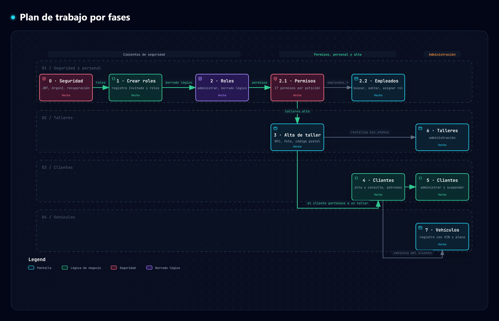

# Plan de estructura de trabajo

Plan del sistema de gestión de un taller mecánico: lo que se realizó en la **capa de seguridad**, las fases que se agregaron después y lo que queda por hacer. Cada fase tiene su análisis en la carpeta [`analisis/`](analisis).

## Mapa del proceso

*Fases del plan y sus dependencias: la seguridad y los permisos habilitan el alta de talleres, los clientes pertenecen a un taller y cada vehículo pertenece a un cliente. Todas las fases están hechas.* Generado con Archify; la versión interactiva (con zoom y búsqueda) está en [`plan-trabajo.html`](./.archify/mapas-procesos-20261009-150000/plan-trabajo.html) y su especificación en [`plan-trabajo.json`](./.archify/mapas-procesos-20261009-150000/plan-trabajo.json).

## 1. Tecnologías

| Capa | Tecnología |
| --- | --- |
| Frontend (SPA) | TypeScript, Vue 3, Vite, Vuetify 3 (paleta: blanco como base y tonos rojos y anaranjados) |
| Backend | Python y FastAPI, con SQLAlchemy |
| Base de datos | SQL Server |
| Seguridad | Hash Argon2 en la base de datos, JWT, permisos por rol validados en el servidor |

## 2. Fases

| Fase | Entregable | Estado | Documento |
| --- | --- | --- | --- |
| 0 | **Capa de seguridad** (ver sección 3) | ✅ Hecha | este documento |
| 1 | **Crear roles**: creación de cuenta → registro → rol Invitado; el administrador crea roles verificando duplicados y los asigna al dar de alta empleados | ✅ Hecha | [`analisis/crear_roles.md`](analisis/crear_roles.md) |
| 2 | **Administrar roles**: roles de fábrica y personalizados en una sola pantalla; actualizar y eliminar con borrado lógico (`bin_status` → tabla `status`) | ✅ Hecha | [`analisis/administrar_roles.md`](analisis/administrar_roles.md) |
| 2.1 | **Permisos de los roles**: catálogo de permisos, permisos fijos de los roles de fábrica y permisos asignables a los roles personalizados (aplicados en cada petición) | ✅ Hecha | [`analisis/permisos_roles.md`](analisis/permisos_roles.md) |
| 2.2 | **Administrar empleados**: listado con búsqueda y filtros, edición de nombre, sucursal y rol, asignación de rol a cuentas Invitado y borrado lógico de cuentas | ✅ Hecha | [`analisis/administrar_empleados.md`](analisis/administrar_empleados.md) |
| 3 | **Alta de taller mecánico** (sólo administrador): datos, domicilio con autollenado por código postal, foto de hasta 15 MB, taller único y RFC validado | ✅ Hecha | [`analisis/alta_taller.md`](analisis/alta_taller.md) |
| 4 | **Módulo de clientes**: alta con alerta de duplicados y consulta paginada, con patrones de diseño | ✅ Hecha | [`docs/customer-patterns`](docs/customer-patterns/README.md) |
| 5 | **Administración de clientes** (recepcionista y administrador): actualizar datos en ventana modal con el taller bloqueado, trazabilidad en el historial y suspensión sólo del administrador | ✅ Hecha | [`analisis/administrar_clientes.md`](analisis/administrar_clientes.md) |
| 6 | **Administración de talleres** (sólo administrador): buscar, editar datos y foto, renombrar sin perder a los empleados, eliminar lógico y restaurar | ✅ Hecha | [`analisis/administrar_talleres.md`](analisis/administrar_talleres.md) |
| 7 | **Registro de vehículos** (recepcionista y administrador): VIN y placa con expresión regular, imagen de hasta 15 MB, kilometraje opcional, asociado a un cliente; resultado: vehículo activo | ✅ Hecha | [`analisis/registrar_vehiculos.md`](analisis/registrar_vehiculos.md) |

Orden de dependencias: la fase 3 (talleres) es precondición de la fase 4 (los clientes pertenecen a un taller), la fase 7 (vehículos) depende de la 4 y la 5 (cada vehículo pertenece a un cliente activo), y las fases 5 y 6 reutilizan el borrado lógico y la auditoría definidos antes.

## 3. Fase 0 · Capa de seguridad (ya realizada)

| Requisito | Cómo se cubre |
| --- | --- |
| Dividir a los usuarios por roles, cada uno con su sesión y rol | Enum `Role` (Administrador, Recepcionista, Asesor de servicio, Técnico, Cliente, Sistema) y token JWT con el rol; la API valida el rol en cada endpoint (`allow_roles`). |
| Recuperar la contraseña, con opción visible en el login | Enlace «¿Olvidó su contraseña?» en el ingreso → correo con código de 6 dígitos → ventana aparte para verificarlo → cambio de contraseña. El código se guarda con hash, caduca y sirve una sola vez. |
| Sólo el administrador da de alta empleados (nombre completo, correo, rol y sucursal) | `POST /api/users/employees` restringido al administrador; sucursal obligatoria. |
| No se puede saltar el acceso por la URL | Guardas de ruta en el SPA **y** validación del token y del rol en cada petición a la API. |
| Autenticación con usuario y contraseña; sólo usuarios dados de alta; sin duplicados | Login contra la base; cuentas inactivas rechazadas; correo único (restricción en la base y validación en la API). |
| Contraseña cifrada desde la base de datos | Sólo se guarda el hash Argon2; nunca la contraseña. |
| Validaciones en el frontend (TypeScript) y en el backend (FastAPI) | Reglas espejo en ambos lados; el servidor es la autoridad. |
| SPA con Vuetify 3 y paleta blanco/rojo/naranja | Diseño con las tonalidades `#F07820`, `#F06030`, `#F05040`, `#F04050`, `#F03060` y blanco. |

## 4. Campos del alta de taller (pantalla de referencia)

Los campos y sus textos de ayuda siguen la pantalla «Alta de taller mecánico» de referencia (subsistema Taller mecánico). Los marcados con * son obligatorios.

| Sección | Campo | Regla | Ayuda |
| --- | --- | --- | --- |
| Datos del taller | Nombre del taller mecánico * | 3 a 100 caracteres; **único** | «Ej. Servicio Automotriz del Centro» |
| Datos del taller | RFC * | 12 o 13 caracteres con **expresión regular** y fecha real; **único**; se guarda en mayúsculas | «12 o 13 caracteres. Se guardará en mayúsculas.» |
| Datos del taller | Email de contacto * | Correo válido | «contacto@taller.com» |
| Domicilio del taller | Calle y número * | 3 a 150 caracteres | «Incluye número exterior e interior, si corresponde.» |
| Domicilio del taller | Colonia * | Debe existir en el catálogo y corresponder al código postal | Se carga desde el código postal o se elige |
| Domicilio del taller | Código postal * | 5 dígitos; existe en el catálogo | «5 dígitos»; al escribirlo **prellena** estado, municipio y colonia |
| Domicilio del taller | Estado * | Catálogo de estados | «Selecciona un estado» |
| Domicilio del taller | Municipio o alcaldía * | Depende del estado | «Primero selecciona un estado» / «Las opciones corresponden al estado seleccionado.» |
| Foto del taller | Foto * | JPG, PNG o WebP; **máximo 15 MB** | «Agrega una foto de la fachada o del interior del taller.» |

Si la persona **no conoce el código postal**, elige estado, municipio y colonia, y el sistema **carga el código postal**.

## 5. Criterios de aceptación globales

- Ninguna operación se puede ejecutar sin sesión válida y sin el rol correspondiente, ni escribiendo la URL ni llamando a la API.
- Nada se borra físicamente en roles ni talleres: se marca con `bin_status` y se puede restaurar.
- Todas las validaciones existen en el frontend y en el backend.
- Cada fase tiene pruebas automáticas de punta a punta en `backend/tests/` y se verifica en el navegador.
- El aviso de error y la confirmación aparecen junto al botón de envío.

## 6. Pendiente

- Administración de vehículos (editar, eliminar con borrado lógico y restaurar) y su uso en recepción y órdenes de trabajo.
- Restablecer la contraseña desde la administración de empleados y suspender cuentas sin eliminarlas.
- Registrar en la auditoría los cambios de permisos.
- Reimportar un catálogo de códigos postales más reciente (el publicado por Correos de México es de octubre de 2017).
